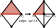
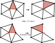
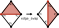
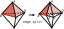
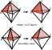
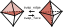
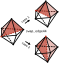

# Local operations

Every algorithm in the toolkit changes a mesh through a small set of local operations: edge
split, edge collapse, edge and face swaps, vertex smoothing. Each one rewrites the cells around a
few vertices and leaves the rest of the mesh alone. This page describes the mesh they work on, how
code points at an element of it, what each operation does, and what happens around an operation:
the hooks an algorithm writes, the invariants it checks, and the rollback when one of them fails.

## A mesh is connectivity plus attributes

The toolkit has two mesh classes: `wmtk::TriMesh`, a triangle mesh (a surface in 3D, or a 2D
domain), and `wmtk::TetMesh`, a tetrahedral mesh. They store connectivity only:

- for each cell (triangle or tetrahedron), its vertices;
- for each vertex, the sorted list of the cells incident to it.

Edges and faces are not stored; they are derived from these two lists when needed. A removed cell
or vertex is flagged, not erased, so ids stay valid during a pass; `consolidate_mesh()` compacts
the storage afterwards and renumbers everything.

Everything else is an attribute: positions, sizing, quality, tags. An algorithm defines plain
structs for the data it needs on vertices, edges, faces and cells, stores them in
`wmtk::AttributeCollection<T>`, and registers the collections with the mesh. The mesh classes
know nothing about geometry; a position is an attribute like any other. Shortest edge collapse,
for instance, keeps this per vertex
([`ShortestEdgeCollapse.h`](https://github.com/wildmeshing/wildmeshing-toolkit/blob/main/components/shortest_edge_collapse/wmtk/components/shortest_edge_collapse/ShortestEdgeCollapse.h)):

```cpp
struct VertexAttributes
{
    Eigen::Vector3d pos;
    size_t partition_id = 0;
    bool freeze = false;
    bool input_boundary = false;
};
```

and registers it in its constructor
([`ShortestEdgeCollapse.cpp`](https://github.com/wildmeshing/wildmeshing-toolkit/blob/main/components/shortest_edge_collapse/wmtk/components/shortest_edge_collapse/ShortestEdgeCollapse.cpp)):

```cpp
    p_vertex_attrs = &vertex_attrs;
    p_face_attrs = &face_attrs;
```

`TriMesh` has the slots `p_vertex_attrs`, `p_edge_attrs` and `p_face_attrs`; `TetMesh` adds
`p_tet_attrs`. Registering a collection is what lets the operations roll it back (see
[Rollback](#rollback)).

## Tuples and navigation

Code names an element of the mesh with a `Tuple`. A tuple holds a vertex, an edge and a face at
once, and in 3D a tetrahedron as well: in `TriMesh` it is a global vertex id, a local edge id and a
global face id; in `TetMesh`, a global vertex id, a local edge id, a local face id and a global
tetrahedron id. The same tuple is read as a vertex, an edge, a face or a cell depending on what is
asked of it: `vid(m)`, `eid(m)`, `fid(m)`, and in 3D `tid(m)`.

Navigation moves from a tuple to a neighbouring one by changing one of its parts and keeping the
others:

| Function | Changes | Keeps |
|---|---|---|
| `switch_vertex(m)` | the vertex, to the other end of the edge | edge, face (and tetrahedron) |
| `switch_edge(m)` | the edge, to the other edge of the face at this vertex | vertex, face (and tetrahedron) |
| `switch_face(m)` | 2D: the triangle, to the next one around the edge; 3D: the face, to the other face of the tetrahedron at this edge | vertex, edge (and tetrahedron) |
| `switch_tetrahedron(m)` | 3D: the tetrahedron, to the one across the face | vertex, edge, face |

The steps that cross into another cell return an optional, empty on the boundary:
`TriMesh::Tuple::switch_face` and `TetMesh::Tuple::switch_tetrahedron`. A `TriMesh` may be
non-manifold: around an edge with more than two triangles, `switch_face` steps through them in
the order of their ids, and `switch_faces` lists the others. The other endpoint of an edge is
`t.switch_vertex(m).vid(m)`; this is how shortest edge collapse reads the two ends of the edge it
is asked to collapse:

```cpp
    const size_t v1 = t.vid(*this);
    const size_t v2 = t.switch_vertex(*this).vid(*this);
```

Each cell carries a hash that every operation rewriting the cell increments, and a tuple stores
the hash of its cell. `t.is_valid(m)` is false when the cell is removed or its hash has changed,
so a tuple taken before an operation is recognised as stale after it. `consolidate_mesh()`
renumbers the mesh and invalidates every tuple.

## The operations

The figures show each operation before and after. The red vertex, the red edge, the darker face
(and the darker tetrahedron in 3D) are the tuple: on the left the tuple the operation is called
with, on the right the tuple its after hook receives, where the figure marks one.

### In 2D

**Edge split** (`split_edge`) adds a vertex on the edge and splits each triangle on it in two.



**Edge collapse** (`collapse_edge`) merges the two ends of the edge. The vertex the tuple points
at is removed, the other end survives, and the triangles on the edge disappear. The default before
hook refuses a collapse that fails the link condition, which would change the topology
(`set_use_link_condition(false)` turns it off).



**Edge swap** (`swap_edge`) replaces the edge shared by two triangles with the other diagonal of
the quadrilateral they form. The default before hook refuses an edge that is not shared by
exactly two triangles, and one whose new diagonal is already an edge.



**Vertex smoothing** (`smooth_vertex`) moves a vertex and does not change the connectivity: the
operation is all in its hooks.

**Face split** (`split_face`) adds a vertex inside a triangle and splits it in three.

### In 3D

**Edge split** (`split_edge`) adds a vertex on the edge and splits each tetrahedron around it in
two.



**Edge collapse** (`collapse_edge`) merges the two ends of the edge; as in 2D, the tuple's vertex
is removed and the other end survives.



**Face swap and edge swap** (`swap_face`, `swap_edge`). The 2-3 face swap replaces two
tetrahedra sharing a face with three around a new edge; the 3-2 edge swap is its inverse, and
replaces the three tetrahedra around an interior edge with two.



**4-4 edge swap** (`swap_edge_44`) replaces the four tetrahedra around an interior edge with four
others around a new edge; there are two ways to do it.



**5-6 edge swap** (`swap_edge_56`) is the same for the five tetrahedra around an interior edge,
which become six.

**Vertex smoothing** (`smooth_vertex`) moves a vertex, as in 2D. **Face split** (`split_face`)
and **tetrahedron split** (`split_tet`) add a vertex inside a face or a tetrahedron.

The scheduler knows the operations by name: `edge_split`, `edge_collapse`, `edge_swap`,
`vertex_smooth` and `face_split` in both dimensions, and in 3D also `face_swap`, `edge_swap_44`,
`edge_swap_56` and `tet_split` (see [Scheduling](scheduling.md)).

## Hooks and invariants

An algorithm specializes the operations by overriding virtual functions of its mesh class. Each
operation has a before hook and an after hook (`split_edge_before` and `split_edge_after`,
`collapse_edge_before` and `collapse_edge_after`, `smooth_before` and `smooth_after`, and so on
for every operation above), and every operation calls the same `invariants`. Each returns `false`
to refuse the operation:

1. **Before hook**, `op_before(t)`: runs before anything changes. It checks whether the operation
   makes sense here and caches what the after hook will need, such as the positions of the two
   ends of an edge.
2. **The connectivity change.** The operation saves the records of the vertices and cells it is
   about to rewrite, then rewrites them.
3. **After hook**, `op_after(t)`: runs on the new connectivity, with the tuple shown in the figures.
   It computes the attributes of the new or changed elements, such as the position of a new
   vertex, and may refuse the result.
4. **Invariants**, `invariants(cells)`: runs on the cells the operation created (for smoothing,
   the cells around the vertex) and checks the conditions every cell must satisfy.

If both pass, the operation commits; otherwise it is rolled back. This is the middle of
`TriMesh::split_edge`
([`TriMesh.cpp`](https://github.com/wildmeshing/wildmeshing-toolkit/blob/main/src/wmtk/TriMesh.cpp)):

```cpp
    new_tris = get_one_ring_tris_for_vertex(new_vertex);
    start_protect_attributes();

    // roll back if not successful
    if (!split_edge_after(return_tuple) || !invariants(new_tris)) {
        // rollback topo
        // restore old v, t
        for (const auto& old_v : old_vertices) {
            m_vertex_connectivity[old_v.first] = old_v.second;
        }
        for (const auto& old_t : old_tris) {
            m_tri_connectivity[old_t.first] = old_t.second;
        }
        // erase new_vid new_fids
        m_vertex_connectivity[new_vid].m_conn_tris.clear();
        m_vertex_connectivity[new_vid].m_is_removed = true;
        for (size_t i = 0; i < fids.size(); ++i) {
            m_tri_connectivity[new_fids[i]].m_is_removed = true;
        }
        rollback_protected_attributes();
        return false;
    }
```

Shortest edge collapse shows the split between the parts. Its after hook places the surviving
vertex (at the midpoint, or on a frozen or boundary endpoint), from positions its before hook
cached. Its invariant is the envelope: every new triangle must stay close to the input surface
([`ShortestEdgeCollapse.cpp`](https://github.com/wildmeshing/wildmeshing-toolkit/blob/main/components/shortest_edge_collapse/wmtk/components/shortest_edge_collapse/ShortestEdgeCollapse.cpp)):

```cpp
bool ShortestEdgeCollapse::invariants(const std::vector<Tuple>& new_tris)
{
    // First: it touches only boundary edges, and is far cheaper than the surface test.
    if (!m_boundary_envelope.boundary_edges_inside(*this, vertex_attrs, new_tris)) {
        return false;
    }
    if (m_has_envelope) {
        for (auto& t : new_tris) {
            std::array<Eigen::Vector3d, 3> tris;
            auto vs = oriented_tri_vertices(t);
            for (auto j = 0; j < 3; j++) tris[j] = vertex_attrs[vs[j].vid(*this)].pos;
            bool outside = m_envelope.is_outside(tris);
            if (outside) return false;
        }
    }
    return true;
}
```

The optimizer meshes of tetwild, triwild and simwild put their checks in the hooks instead. Their
collapse evaluates, in its before hook, the cells it would create, and refuses when one would be
inverted or would raise the worst energy around the edge; its after hook refuses when a surface
face leaves the envelope (see [Quality](quality.md) and [Robust geometry](robust-geometry.md)).

In a parallel pass the scheduler may run an operation as a *dry run* first: the before hook and
the checks that precede the first change run, and the operation stops there (see
[Scheduling](scheduling.md#parallel-passes)). A before hook that only reads the mesh and writes
per-thread caches works unchanged in both cases. One that writes to the mesh must skip the write
in a dry run, when other threads read the same vertices without locks; `dry_run()` says when, and
the optimizer's rounding checks it.

## Rollback

When the after hook or the invariants refuse, the operation is undone, and the mesh is exactly
as it was before it started:

- **Connectivity.** The saved records of every vertex and cell the operation rewrote are written
  back, with their hashes, so tuples taken before the operation are valid again. The vertices
  and cells the operation created are marked removed.
- **Attributes.** Between `start_protect_attributes()` and the decision, every entry of a
  registered collection that the code reaches through non-const access is copied, on first
  access, to a per-thread list; `rollback_protected_attributes()` writes those copies back.
  Reading through const access records nothing
  ([`AttributeCollection.hpp`](https://github.com/wildmeshing/wildmeshing-toolkit/blob/main/src/wmtk/AttributeCollection.hpp)):

    ```cpp
        T& operator[](size_t i)
        {
            if (recording.local()) {
                m_rollback_list.local().emplace(i, m_attributes[i]);
            }
            return m_attributes[i];
        }
    ```

What is not restored: anything written by the before hook, which runs before the protection
starts, and any state outside the registered collections (member variables, caches, counters).
So a before hook writes only what may stay written when the operation is refused (the optimizer's
smoothing rounds the vertex's coordinates there, which is valid either way), and an after hook
writes nothing outside the collections that a refusal would have to undo. Vertex smoothing
changes no connectivity, so its rollback is the attribute part alone.

## See also

- [Scheduling](scheduling.md): how operations are queued and run.
- [Writing an operation](../developer/writing-an-operation.md) in the developer guide.
- The API reference of [`TriMesh`](https://github.com/wildmeshing/wildmeshing-toolkit/blob/main/src/wmtk/TriMesh.h)
  and [`TetMesh`](https://github.com/wildmeshing/wildmeshing-toolkit/blob/main/src/wmtk/TetMesh.h).
